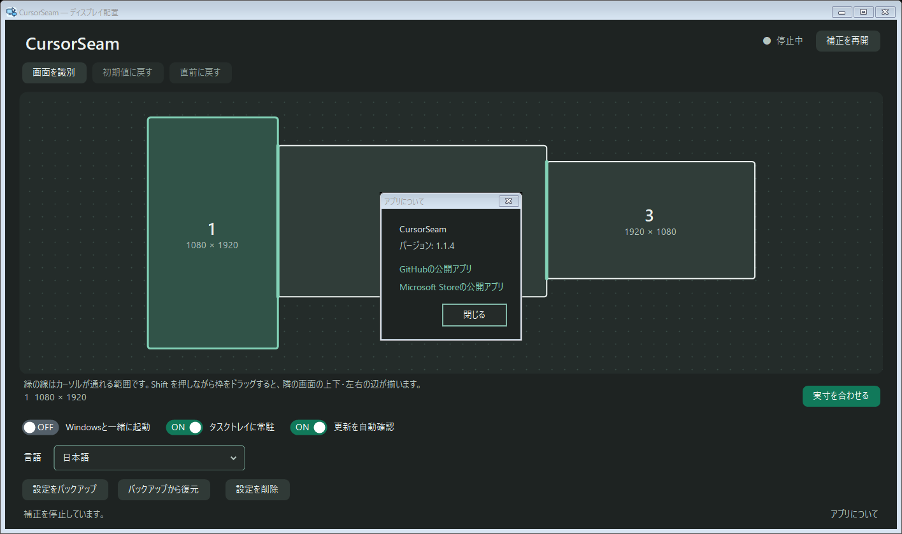

# CursorSeam

**日本語** · [English](docs/en/README.md) · [한국어](docs/ko/README.md) · [简体中文](docs/zh-Hans/README.md) · [繁體中文](docs/zh-Hant/README.md) · [Deutsch](docs/de/README.md) · [Français](docs/fr/README.md) · [Español](docs/es/README.md) · [Português (Brasil)](docs/pt-BR/README.md)

カーソルがモニターの境目を越えるとき、上下や左右にずれるのを補正する Windows アプリです。サイズや解像度が異なるモニターを2台以上つないで使います。

## 入手方法

[最新版のリリース](https://github.com/nekomimiyks/CursorSeam/releases/latest)から `CursorSeam-…-Setup.exe` をダウンロードして実行します。インストール完了時に **はい** を選ぶと起動し、**いいえ** を選ぶと起動せずに終了します。更新しても既存の設定は引き継がれます。

## 使い方

1. **画面を識別**で番号を確認し、枠をドラッグして机の上と同じ配置にします。
2. **実寸を合わせる**を押し、枠の辺や角をドラッグしてモニターの大きさを合わせます。Shift を押しながらドラッグすると、隣の画面の辺に吸着します。
3. **設定を保存**を押し、画面の境目でカーソルの動きを確かめます。

## 1.1.4 の変更

アイコンを、大小の横長モニターと白いカーソルを描いた明るい空色のデザインに変更しました。

右下の **アプリについて** から、起動中のバージョンと GitHub・Microsoft Store の公開アプリを確認できます。Microsoft Store アプリを起動できない場合は、既定のブラウザーで一覧を開きます。

## 設定のバックアップと復元

**設定をバックアップ**で `.cursorseam` ファイルを保存します。戻すには **バックアップから復元**でそのファイルを選び、確認します。配置・実寸・常駐・言語が復元されます。Windows 起動時の自動起動は個別に設定してください。

## 更新の自動確認

GitHub 版は設定欄の **更新を自動確認** がオンのとき、起動後と起動中は1日1回、GitHub の新しいリリースを確認します。更新がある場合は **更新** ボタンを押すと、インストーラーをダウンロードして検証し、セットアップを起動します。インストーラーではデスクトップにショートカットを作成するか選べます。

## ライセンス

[MITライセンス](LICENSE)
