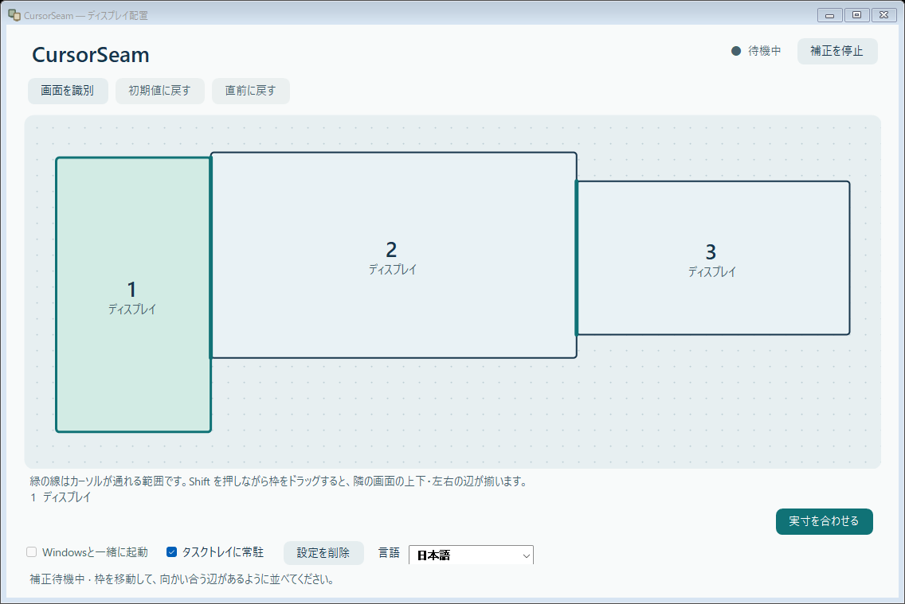
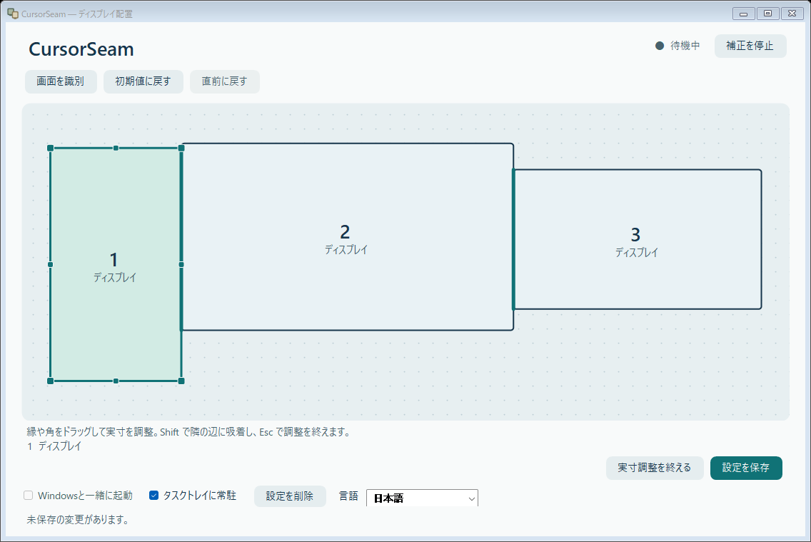

# CursorSeam

**日本語** · [English](docs/en/README.md) · [한국어](docs/ko/README.md) · [简体中文](docs/zh-Hans/README.md) · [繁體中文](docs/zh-Hant/README.md) · [Deutsch](docs/de/README.md) · [Français](docs/fr/README.md) · [Español](docs/es/README.md) · [Português (Brasil)](docs/pt-BR/README.md)

カーソルがモニターの境目を越えるとき、上下や左右にずれるのを補正する Windows アプリです。サイズや解像度が異なるモニターを2台以上つないで使います。

## 使い方

1. **画面を識別**で番号を確認し、枠をドラッグして机の上と同じ配置にします。
2. **実寸を合わせる**を押し、枠の辺や角をドラッグしてモニターの大きさを合わせます。Shift を押しながらドラッグすると、隣の画面の辺に吸着します。
3. **設定を保存**を押し、画面の境目でカーソルの動きを確かめます。

## 入手方法

ソースから試すには、Windows PowerShell で `.\build.ps1` を実行し、生成された `CursorSeam.exe` を開きます。

## ライセンス

[MITライセンス](LICENSE)
