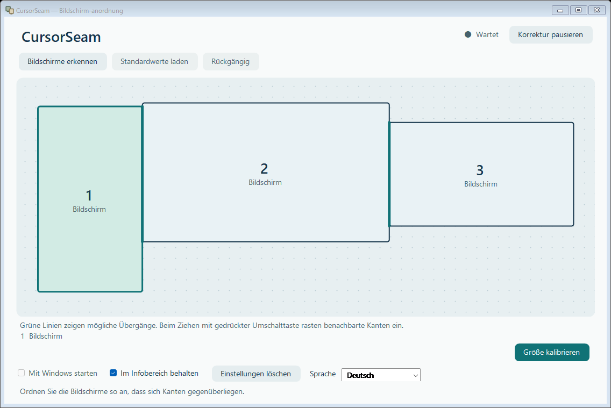
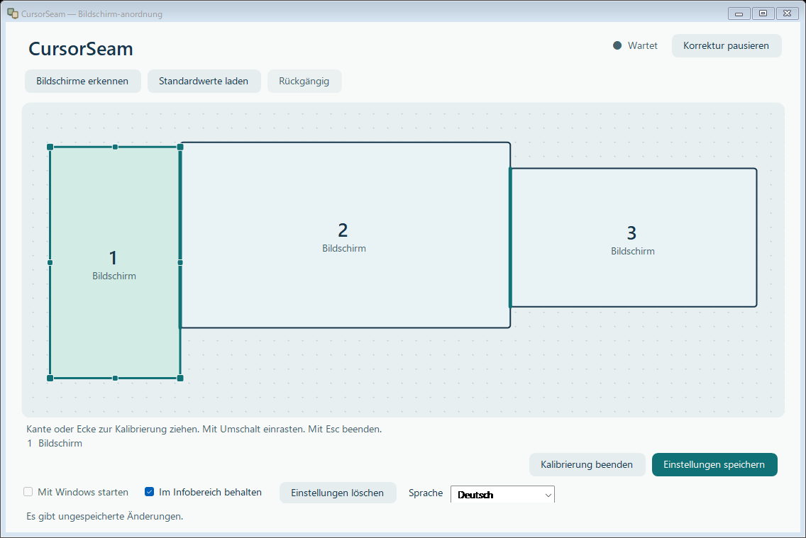

# CursorSeam

[日本語](../../README.md) · [English](../en/README.md) · [한국어](../ko/README.md) · [简体中文](../zh-Hans/README.md) · [繁體中文](../zh-Hant/README.md) · **Deutsch** · [Français](../fr/README.md) · [Español](../es/README.md) · [Português (Brasil)](../pt-BR/README.md)

CursorSeam korrigiert die Position des Mauszeigers beim Wechsel zwischen Bildschirmen unter Windows. Die App ist für zwei oder mehr Bildschirme mit unterschiedlichen Größen oder Auflösungen gedacht.

## Bedienung

1. Klicken Sie auf **Bildschirme erkennen**, um die Nummern zu prüfen. Ziehen Sie die Rahmen an die Positionen Ihrer Bildschirme auf dem Schreibtisch.
2. Wählen Sie **Größe kalibrieren** und ziehen Sie an einer Kante oder Ecke, bis die Größe stimmt. Halten Sie beim Ziehen die Umschalttaste gedrückt, um an einer benachbarten Kante einzurasten.
3. Klicken Sie auf **Einstellungen speichern** und bewegen Sie den Mauszeiger über eine Bildschirmkante, um das Ergebnis zu prüfen.

## Ausführen

Führen Sie `.\build.ps1` in Windows PowerShell aus und öffnen Sie anschließend die erzeugte Datei `CursorSeam.exe`.

## Lizenz

[MIT-Lizenz](../../LICENSE)
