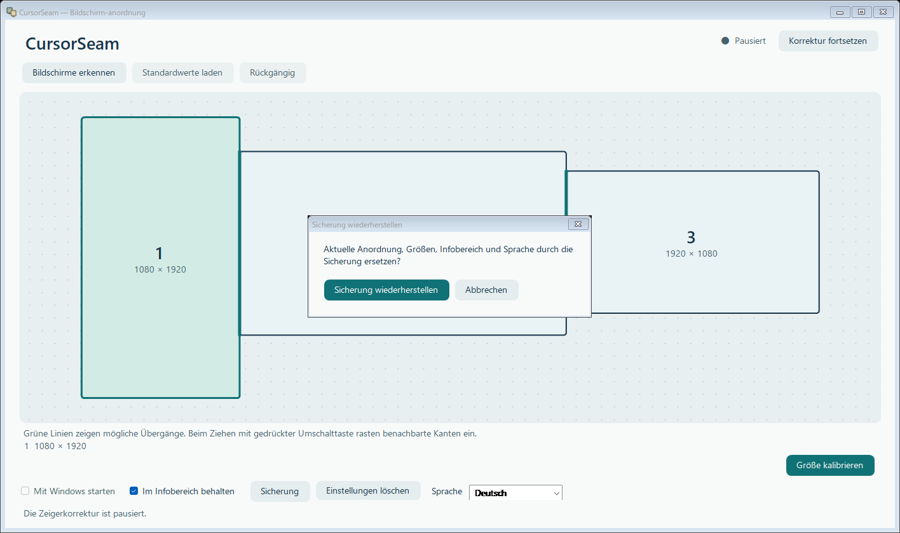

# CursorSeam

[日本語](../../README.md) · [English](../en/README.md) · [한국어](../ko/README.md) · [简体中文](../zh-Hans/README.md) · [繁體中文](../zh-Hant/README.md) · **Deutsch** · [Français](../fr/README.md) · [Español](../es/README.md) · [Português (Brasil)](../pt-BR/README.md)

CursorSeam korrigiert die Position des Mauszeigers beim Wechsel zwischen Bildschirmen unter Windows. Die App ist für zwei oder mehr Bildschirme mit unterschiedlichen Größen oder Auflösungen gedacht.

## Installation

Lade `CursorSeam-…-Setup.exe` aus der [neuesten Version](https://github.com/nekomimiyks/CursorSeam/releases/latest) herunter und führe die Datei aus. Wähle am Ende **Ja**, um die App zu starten, oder **Nein**, um das Setup ohne Start zu beenden. Deine Einstellungen bleiben bei Updates erhalten.

## Bedienung

1. Klicken Sie auf **Bildschirme erkennen**, um die Nummern zu prüfen. Ziehen Sie die Rahmen an die Positionen Ihrer Bildschirme auf dem Schreibtisch.
2. Wählen Sie **Größe kalibrieren** und ziehen Sie an einer Kante oder Ecke, bis die Größe stimmt. Halten Sie beim Ziehen die Umschalttaste gedrückt, um an einer benachbarten Kante einzurasten.
3. Klicken Sie auf **Einstellungen speichern** und bewegen Sie den Mauszeiger über eine Bildschirmkante, um das Ergebnis zu prüfen.

## Neu in 1.1.0

Einstellungen lassen sich in einer Datei sichern und mit denselben Bildschirmen wiederherstellen. Auf GitHub steht ein Windows-Installationsprogramm bereit.

## Einstellungen sichern und wiederherstellen

Wähle **Sicherung → Sicherung speichern**, um eine `.cursorseam`-Datei zu speichern. Wähle zum Wiederherstellen **Sicherung → Sicherung wiederherstellen**, öffne die Datei und bestätige. Anordnung, Abmessungen, Infobereich und Sprache werden wiederhergestellt. Stelle den Windows-Autostart separat ein.

## Lizenz

[MIT-Lizenz](../../LICENSE)
