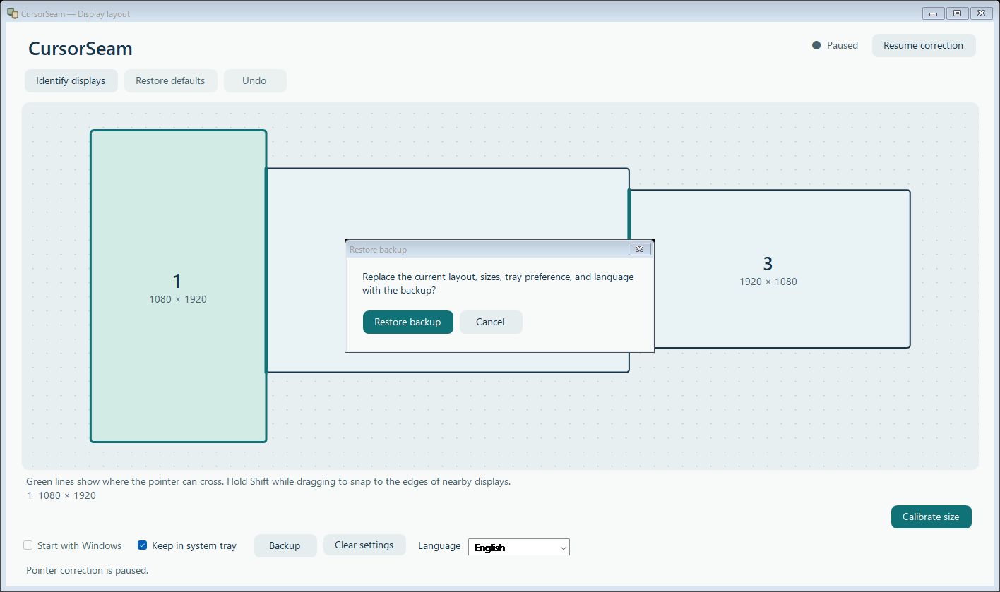

# CursorSeam

[日本語](../../README.md) · **English** · [한국어](../ko/README.md) · [简体中文](../zh-Hans/README.md) · [繁體中文](../zh-Hant/README.md) · [Deutsch](../de/README.md) · [Français](../fr/README.md) · [Español](../es/README.md) · [Português (Brasil)](../pt-BR/README.md)

CursorSeam keeps the mouse pointer aligned as it crosses between monitors. It works with two or more Windows displays, including ones with different sizes or resolutions.

## Install

Download and run `CursorSeam-…-Setup.exe` from the [latest release](https://github.com/nekomimiyks/CursorSeam/releases/latest). When setup finishes, select **Yes** to launch the app or **No** to finish without launching it. Updates keep your existing settings.

## How to use

1. Select **Identify displays** to check the numbers, then drag the display outlines to match your desk.
2. Select **Calibrate size**, then drag an edge or corner to match the monitor's physical size. Hold Shift while dragging to snap to a neighboring edge.
3. Select **Save settings**, then move the pointer across a display boundary to check the result.

## What’s new in 1.1.0

Save your settings to a backup file and restore them with the same monitors connected. The GitHub release now includes a Windows installer.

## Back up and restore settings

Choose **Backup → Save backup** to save a `.cursorseam` file. To restore it, choose **Backup → Restore backup**, select the file, and confirm. This restores the layout, physical sizes, tray preference, and language. Set Windows startup separately.

## License

[MIT License](../../LICENSE)
