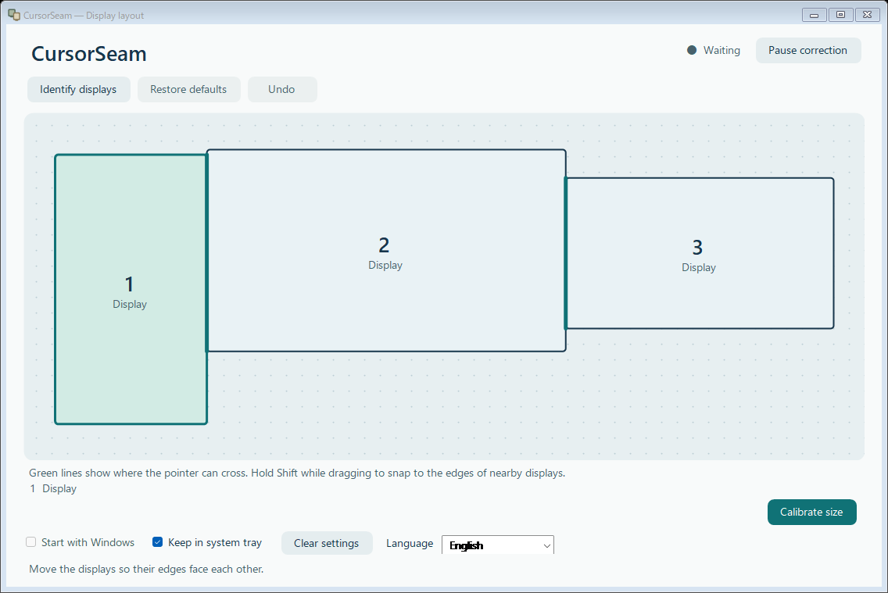
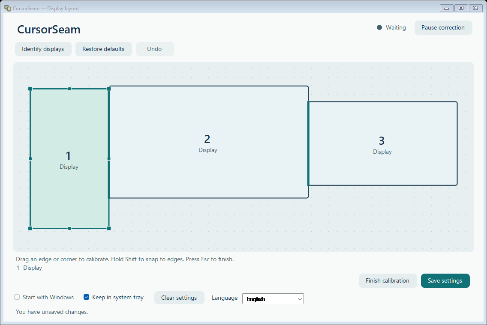

# CursorSeam

[日本語](../../README.md) · **English** · [한국어](../ko/README.md) · [简体中文](../zh-Hans/README.md) · [繁體中文](../zh-Hant/README.md) · [Deutsch](../de/README.md) · [Français](../fr/README.md) · [Español](../es/README.md) · [Português (Brasil)](../pt-BR/README.md)

CursorSeam keeps the mouse pointer aligned as it crosses between monitors. It works with two or more Windows displays, including ones with different sizes or resolutions.

## How to use

1. Select **Identify displays** to check the numbers, then drag the display outlines to match your desk.
2. Select **Calibrate size**, then drag an edge or corner to match the monitor's physical size. Hold Shift while dragging to snap to a neighboring edge.
3. Select **Save settings**, then move the pointer across a display boundary to check the result.

## Get started

To try it from source, run `.\build.ps1` in Windows PowerShell, then open the generated `CursorSeam.exe`.

## License

[MIT License](../../LICENSE)
