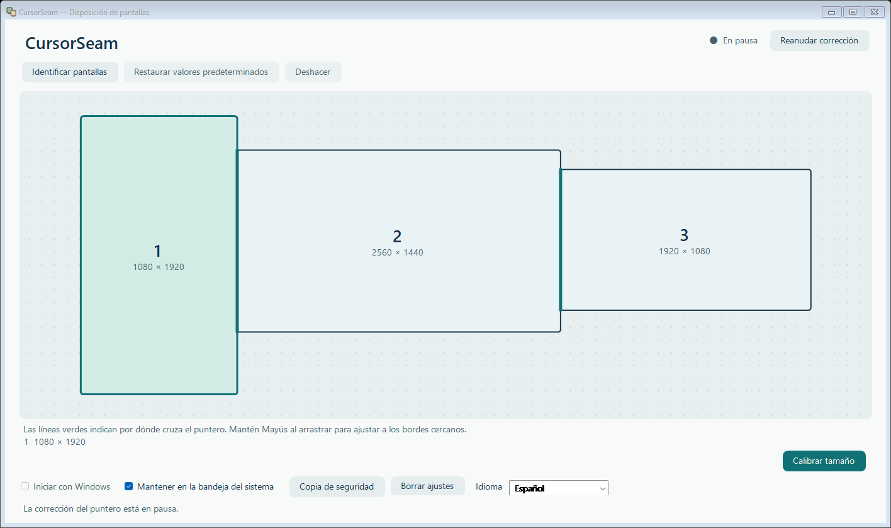
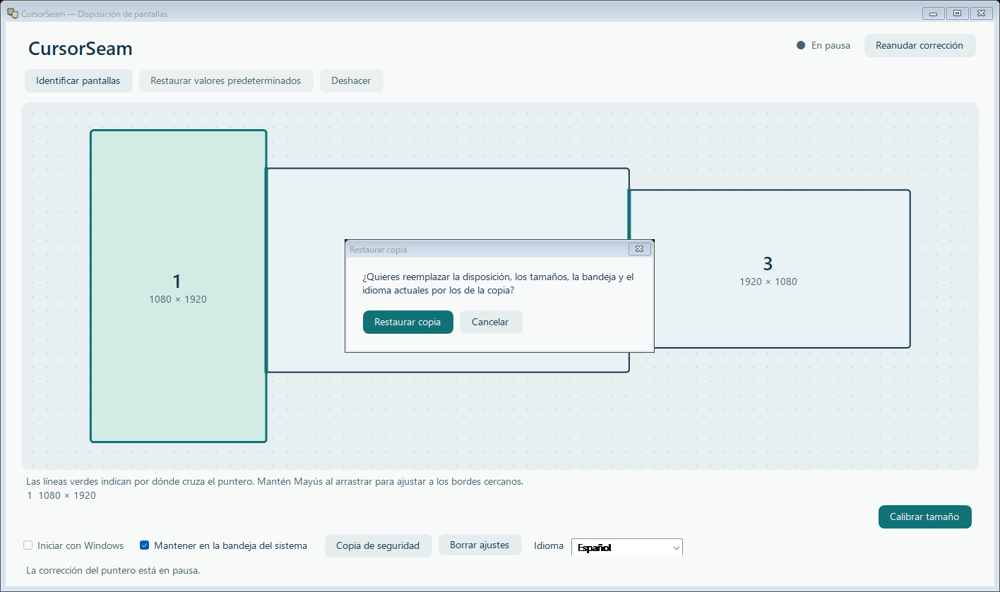

# CursorSeam

[日本語](../../README.md) · [English](../en/README.md) · [한국어](../ko/README.md) · [简体中文](../zh-Hans/README.md) · [繁體中文](../zh-Hant/README.md) · [Deutsch](../de/README.md) · [Français](../fr/README.md) · **Español** · [Português (Brasil)](../pt-BR/README.md)

CursorSeam corrige la posición del puntero del ratón al pasar de una pantalla a otra en Windows. Funciona con dos o más pantallas, incluso si tienen tamaños o resoluciones diferentes.

## Instalación

Descarga y ejecuta `CursorSeam-…-Setup.exe` desde la [última versión](https://github.com/nekomimiyks/CursorSeam/releases/latest). Al finalizar, selecciona **Sí** para abrir la aplicación o **No** para salir sin abrirla. Las actualizaciones conservan tus ajustes.

## Cómo se usa

1. Pulsa **Identificar pantallas** para comprobar sus números. Arrastra los marcos hasta que coincidan con la disposición de tus pantallas en el escritorio.
2. Pulsa **Calibrar tamaño** y arrastra un borde o una esquina para ajustar el tamaño físico. Mantén pulsada Mayús al arrastrar para alinear los bordes contiguos.
3. Pulsa **Guardar ajustes** y mueve el puntero de una pantalla a otra para comprobar el resultado.

## Novedades de la versión 1.1.0

Puedes guardar tus ajustes en un archivo y restaurarlos con las mismas pantallas conectadas. La versión de GitHub incluye un instalador para Windows.

## Copia y restauración de ajustes

Elige **Copia de seguridad → Guardar copia** para guardar un archivo `.cursorseam`. Para restaurar, elige **Copia de seguridad → Restaurar copia**, selecciona el archivo y confirma. Se restauran la disposición, los tamaños físicos, la opción de bandeja y el idioma. Configura el inicio con Windows por separado.

## Licencia

[Licencia MIT](../../LICENSE)
