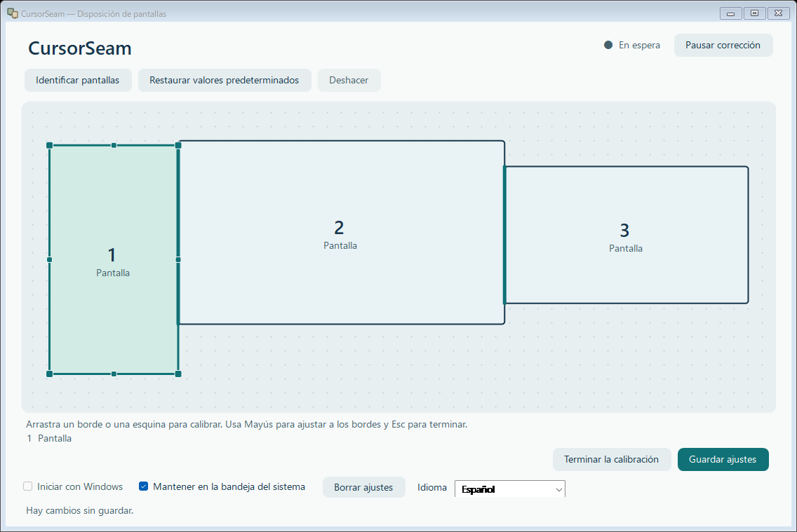

# CursorSeam

[日本語](../../README.md) · [English](../en/README.md) · [한국어](../ko/README.md) · [简体中文](../zh-Hans/README.md) · [繁體中文](../zh-Hant/README.md) · [Deutsch](../de/README.md) · [Français](../fr/README.md) · **Español** · [Português (Brasil)](../pt-BR/README.md)

CursorSeam corrige la posición del puntero del ratón al pasar de una pantalla a otra en Windows. Funciona con dos o más pantallas, incluso si tienen tamaños o resoluciones diferentes.

## Cómo se usa

1. Pulsa **Identificar pantallas** para comprobar sus números. Arrastra los marcos hasta que coincidan con la disposición de tus pantallas en el escritorio.
2. Pulsa **Calibrar tamaño** y arrastra un borde o una esquina para ajustar el tamaño físico. Mantén pulsada Mayús al arrastrar para alinear los bordes contiguos.
3. Pulsa **Guardar ajustes** y mueve el puntero de una pantalla a otra para comprobar el resultado.

## Cómo ejecutarlo

Ejecuta `.\build.ps1` en Windows PowerShell y abre el archivo `CursorSeam.exe` que se genera.

## Licencia

[Licencia MIT](../../LICENSE)
