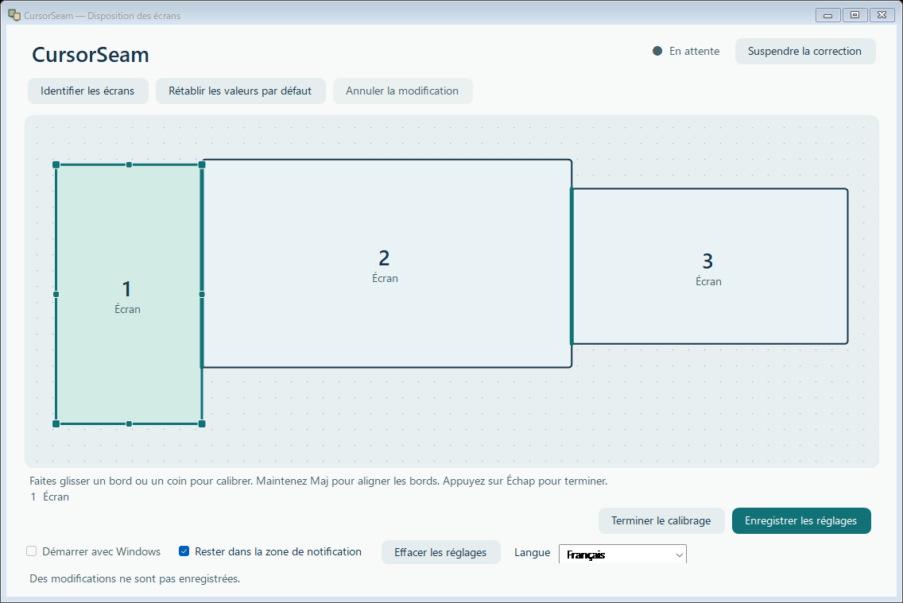

# CursorSeam

[日本語](../../README.md) · [English](../en/README.md) · [한국어](../ko/README.md) · [简体中文](../zh-Hans/README.md) · [繁體中文](../zh-Hant/README.md) · [Deutsch](../de/README.md) · **Français** · [Español](../es/README.md) · [Português (Brasil)](../pt-BR/README.md)

CursorSeam corrige la position du pointeur de la souris lorsqu’il passe d’un écran à l’autre sous Windows. L’application fonctionne avec au moins deux écrans, même s’ils ont des tailles ou des résolutions différentes.

## Utilisation

1. Cliquez sur **Identifier les écrans** pour vérifier leur numéro, puis faites glisser les cadres pour reproduire leur disposition sur votre bureau.
2. Cliquez sur **Calibrer la taille**, puis faites glisser un bord ou un coin pour ajuster la taille réelle. Maintenez Maj enfoncée pendant le déplacement pour aligner les bords voisins.
3. Cliquez sur **Enregistrer les réglages**, puis faites passer le pointeur d’un écran à l’autre pour vérifier le résultat.

## Lancement

Exécutez `.\build.ps1` dans Windows PowerShell, puis ouvrez le fichier `CursorSeam.exe` généré.

## Licence

[Licence MIT](../../LICENSE)
