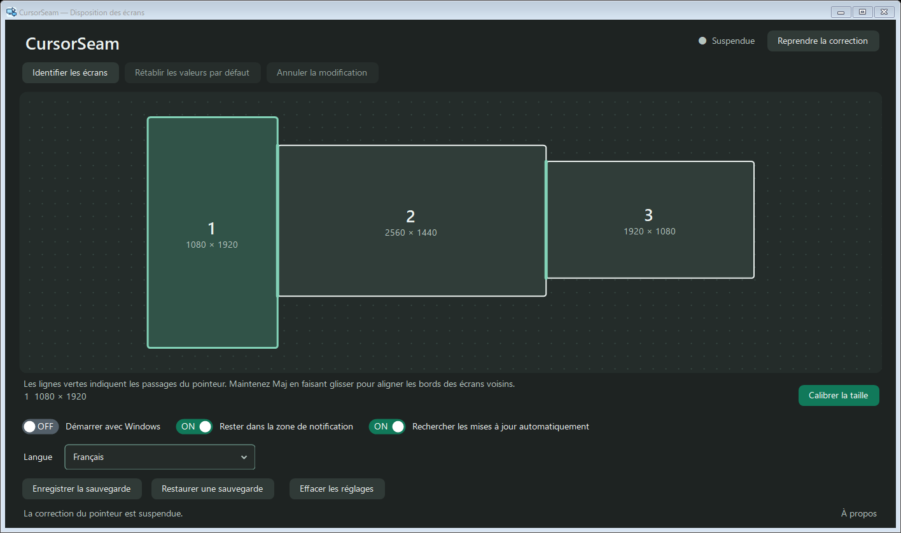
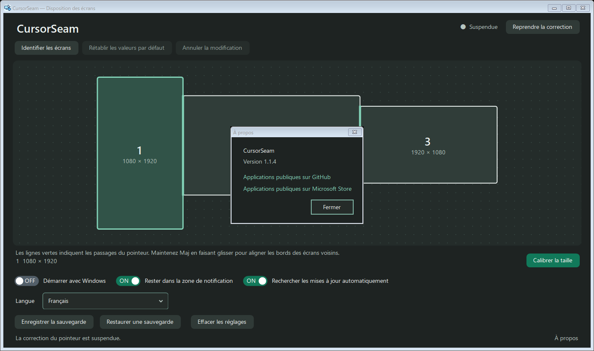
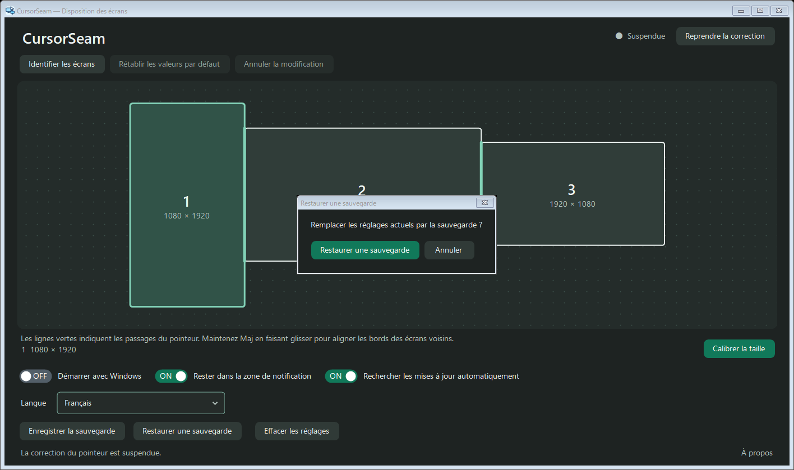

# CursorSeam

[日本語](../../README.md) · [English](../en/README.md) · [한국어](../ko/README.md) · [简体中文](../zh-Hans/README.md) · [繁體中文](../zh-Hant/README.md) · [Deutsch](../de/README.md) · **Français** · [Español](../es/README.md) · [Português (Brasil)](../pt-BR/README.md)

CursorSeam corrige la position du pointeur de la souris lorsqu’il passe d’un écran à l’autre sous Windows. L’application fonctionne avec au moins deux écrans, même s’ils ont des tailles ou des résolutions différentes.

## Installation

Téléchargez puis exécutez `CursorSeam-…-Setup.exe` depuis la [dernière version](https://github.com/nekomimiyks/CursorSeam/releases/latest). À la fin de l’installation, choisissez **Oui** pour lancer l’application ou **Non** pour terminer sans la lancer. Les mises à jour conservent les réglages existants.

## Utilisation

1. Cliquez sur **Identifier les écrans** pour vérifier leur numéro, puis faites glisser les cadres pour reproduire leur disposition sur votre bureau.
2. Cliquez sur **Calibrer la taille**, puis faites glisser un bord ou un coin pour ajuster la taille réelle. Maintenez Maj enfoncée pendant le déplacement pour aligner les bords voisins.
3. Cliquez sur **Enregistrer les réglages**, puis faites passer le pointeur d’un écran à l’autre pour vérifier le résultat.

## Nouveautés de la version 1.1.4

La nouvelle icône montre deux écrans larges de tailles différentes et un pointeur blanc sur fond bleu ciel.

**À propos**, en bas à droite, affiche la version en cours d’exécution et les liens vers les applications publiques sur GitHub et Microsoft Store. Si l’application Microsoft Store ne peut pas démarrer, la liste s’ouvre dans le navigateur par défaut.

## Sauvegarder et restaurer les réglages

Sélectionnez **Enregistrer la sauvegarde** pour créer un fichier `.cursorseam`. Pour le restaurer, sélectionnez **Restaurer une sauvegarde**, ouvrez le fichier et confirmez. La disposition, les dimensions, la zone de notification et la langue sont restaurées. Le démarrage avec Windows se règle séparément.

## Recherche automatique de mises à jour

Lorsque **Rechercher les mises à jour automatiquement** est activé, la version GitHub vérifie les nouvelles versions peu après le démarrage, puis une fois par jour. Sélectionnez **Mettre à jour** pour télécharger et vérifier le programme d’installation, puis le lancer. Le programme d’installation permet de créer un raccourci sur le bureau.

## Licence

[Licence MIT](../../LICENSE)
