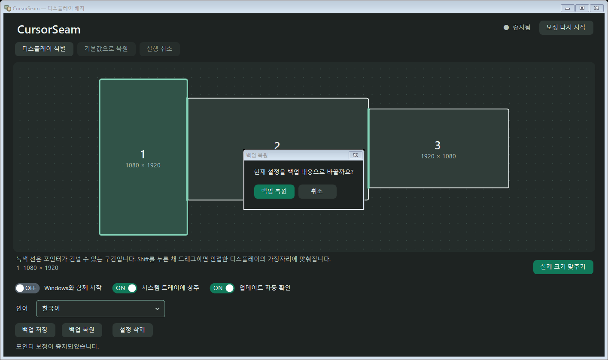

# CursorSeam

[日本語](../../README.md) · [English](../en/README.md) · **한국어** · [简体中文](../zh-Hans/README.md) · [繁體中文](../zh-Hant/README.md) · [Deutsch](../de/README.md) · [Français](../fr/README.md) · [Español](../es/README.md) · [Português (Brasil)](../pt-BR/README.md)

CursorSeam은 마우스 포인터가 모니터 경계를 지날 때 위아래나 좌우로 어긋나는 현상을 보정하는 Windows 앱입니다. 크기나 해상도가 다른 모니터를 포함해 두 대 이상 연결한 환경에서 사용할 수 있습니다.

## 설치

[최신 릴리스](https://github.com/nekomimiyks/CursorSeam/releases/latest)에서 `CursorSeam-…-Setup.exe`를 다운로드하여 실행합니다. 설치가 끝나면 **예**를 선택해 앱을 시작하거나 **아니요**를 선택해 시작하지 않고 종료합니다. 업데이트 시 기존 설정이 유지됩니다.

## 사용 방법

1. **디스플레이 식별**로 번호를 확인하고, 화면의 테두리를 끌어 실제 모니터 배치에 맞춥니다.
2. **실제 크기 맞추기**를 누른 뒤 화면의 가장자리나 모서리를 끌어 크기를 맞춥니다. Shift를 누른 채 끌면 인접한 화면의 가장자리에 맞춰집니다.
3. **설정 저장**을 누르고 포인터를 화면 경계 너머로 움직여 확인합니다.

## 1.1.2의 변경 사항

스위치 글자가 겹치는 문제를 수정하고 설정 영역의 간격을 조정했습니다. 실제 크기 조정 버튼을 배치 보드 오른쪽 아래에 두었습니다. GitHub 버전은 업데이트 자동 확인과 앱에서 업데이트 시작을 지원하며, 설치 시 바탕 화면 바로 가기를 만들 수 있습니다.

## 설정 백업 및 복원

**백업 저장**에서 `.cursorseam` 파일을 저장합니다. 복원하려면 **백업 복원**을 선택한 다음 파일을 골라 확인합니다. 배치, 실제 크기, 트레이 설정, 언어가 복원됩니다. Windows 시작 시 자동 실행은 별도로 설정하세요.

## 업데이트 자동 확인

GitHub 버전은 **업데이트 자동 확인**을 켜면 시작 직후와 실행 중 하루에 한 번 새 릴리스를 확인합니다. 업데이트가 있으면 **업데이트**를 선택하여 설치 파일을 다운로드하고 검증한 뒤 설치를 시작합니다. 설치할 때 바탕 화면 바로 가기를 만들지 선택할 수 있습니다.

## 라이선스

[MIT 라이선스](../../LICENSE)
