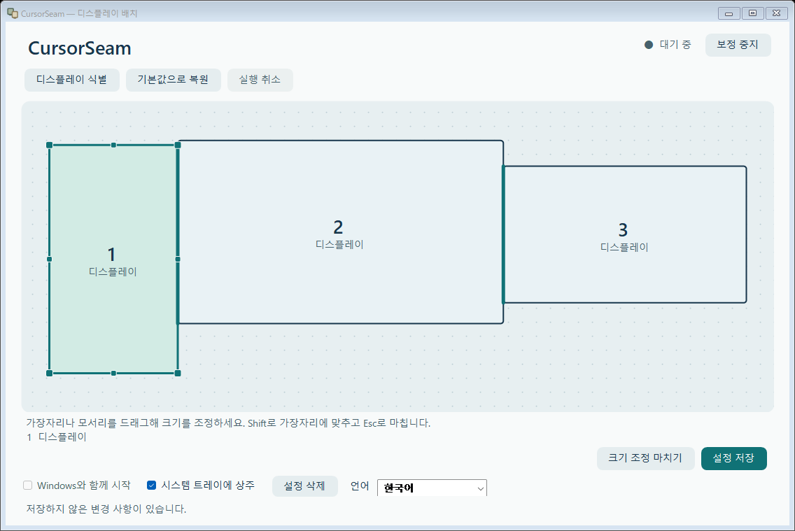

# CursorSeam

[日本語](../../README.md) · [English](../en/README.md) · **한국어** · [简体中文](../zh-Hans/README.md) · [繁體中文](../zh-Hant/README.md) · [Deutsch](../de/README.md) · [Français](../fr/README.md) · [Español](../es/README.md) · [Português (Brasil)](../pt-BR/README.md)

CursorSeam은 마우스 포인터가 모니터 경계를 지날 때 위아래나 좌우로 어긋나는 현상을 보정하는 Windows 앱입니다. 크기나 해상도가 다른 모니터를 포함해 두 대 이상 연결한 환경에서 사용할 수 있습니다.

## 사용 방법

1. **디스플레이 식별**로 번호를 확인하고, 화면의 테두리를 끌어 실제 모니터 배치에 맞춥니다.
2. **실제 크기 맞추기**를 누른 뒤 화면의 가장자리나 모서리를 끌어 크기를 맞춥니다. Shift를 누른 채 끌면 인접한 화면의 가장자리에 맞춰집니다.
3. **설정 저장**을 누르고 포인터를 화면 경계 너머로 움직여 확인합니다.

## 실행 방법

Windows PowerShell에서 `.\build.ps1`을 실행한 뒤 생성된 `CursorSeam.exe`를 엽니다.

## 라이선스

[MIT 라이선스](../../LICENSE)
