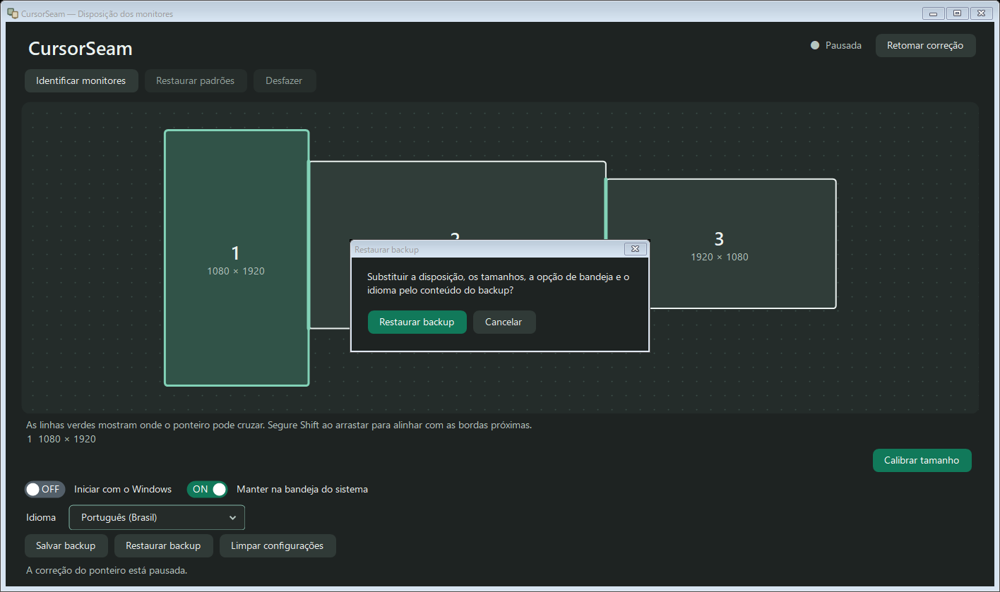

# CursorSeam

[日本語](../../README.md) · [English](../en/README.md) · [한국어](../ko/README.md) · [简体中文](../zh-Hans/README.md) · [繁體中文](../zh-Hant/README.md) · [Deutsch](../de/README.md) · [Français](../fr/README.md) · [Español](../es/README.md) · **Português (Brasil)**

O CursorSeam corrige a posição do ponteiro ao passar de um monitor para outro no Windows. Funciona com dois ou mais monitores, inclusive quando têm tamanhos ou resoluções diferentes.

## Instalação

Baixe e execute `CursorSeam-…-Setup.exe` da [versão mais recente](https://github.com/nekomimiyks/CursorSeam/releases/latest). No fim da instalação, selecione **Sim** para abrir o aplicativo ou **Não** para sair sem abri-lo. As atualizações mantêm suas configurações.

## Como usar

1. Clique em **Identificar monitores** para conferir os números. Arraste as molduras até que correspondam à posição dos monitores na sua mesa.
2. Clique em **Calibrar tamanho** e arraste uma borda ou um canto para ajustar o tamanho físico. Segure Shift ao arrastar para alinhar bordas vizinhas.
3. Clique em **Salvar configurações** e mova o ponteiro entre os monitores para conferir o resultado.

## Novidades da versão 1.1.1

O CursorSeam acompanha o modo claro ou escuro do Windows. As configurações incluem botões de ativação, um seletor de idioma mais largo e botões de backup e restauração. O instalador do GitHub pode fechar a versão 1.1.1 ou posterior durante a atualização. Ao atualizar da versão 1.1.0 ou anterior, feche o CursorSeam pela bandeja do sistema primeiro.

## Backup e restauração das configurações

Selecione **Salvar backup** para salvar um arquivo `.cursorseam`. Para restaurar, selecione **Restaurar backup**, escolha o arquivo e confirme. A disposição, os tamanhos físicos, a opção da bandeja e o idioma serão restaurados. Configure a inicialização com o Windows separadamente.

## Licença

[Licença MIT](../../LICENSE)
