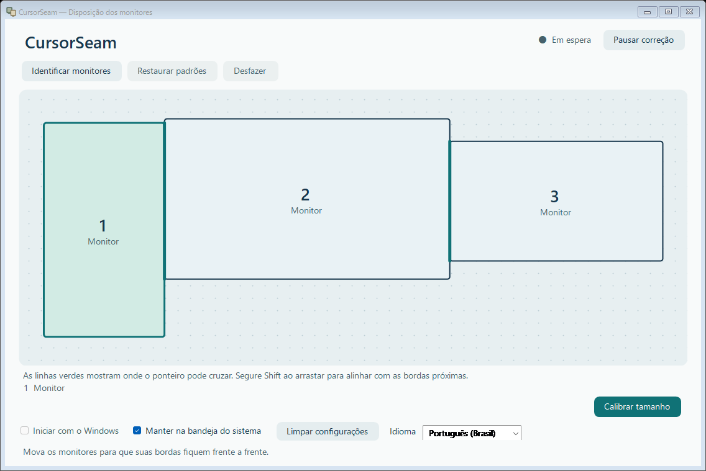
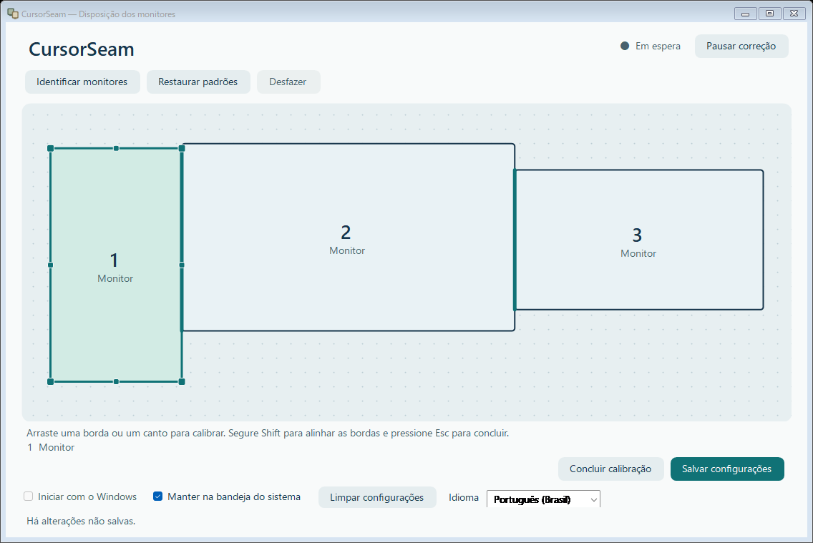

# CursorSeam

[日本語](../../README.md) · [English](../en/README.md) · [한국어](../ko/README.md) · [简体中文](../zh-Hans/README.md) · [繁體中文](../zh-Hant/README.md) · [Deutsch](../de/README.md) · [Français](../fr/README.md) · [Español](../es/README.md) · **Português (Brasil)**

O CursorSeam corrige a posição do ponteiro ao passar de um monitor para outro no Windows. Funciona com dois ou mais monitores, inclusive quando têm tamanhos ou resoluções diferentes.

## Como usar

1. Clique em **Identificar monitores** para conferir os números. Arraste as molduras até que correspondam à posição dos monitores na sua mesa.
2. Clique em **Calibrar tamanho** e arraste uma borda ou um canto para ajustar o tamanho físico. Segure Shift ao arrastar para alinhar bordas vizinhas.
3. Clique em **Salvar configurações** e mova o ponteiro entre os monitores para conferir o resultado.

## Como executar

Execute `.\build.ps1` no Windows PowerShell e abra o arquivo `CursorSeam.exe` gerado.

## Licença

[Licença MIT](../../LICENSE)
