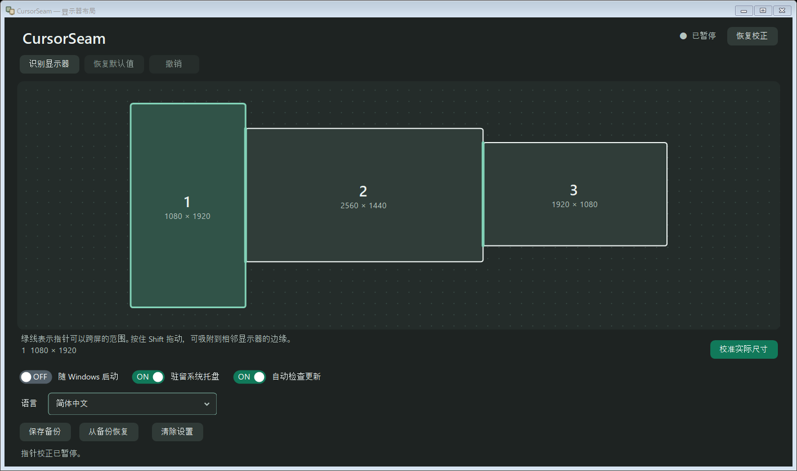
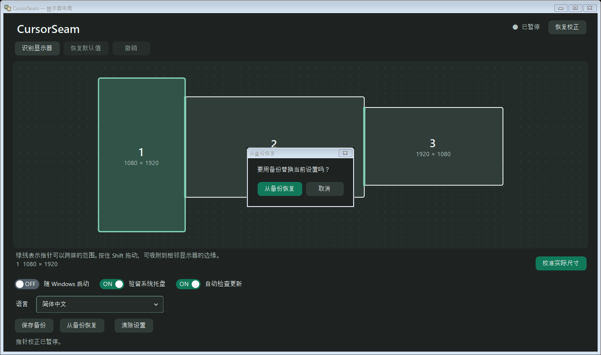

# CursorSeam

[日本語](../../README.md) · [English](../en/README.md) · [한국어](../ko/README.md) · **简体中文** · [繁體中文](../zh-Hant/README.md) · [Deutsch](../de/README.md) · [Français](../fr/README.md) · [Español](../es/README.md) · [Português (Brasil)](../pt-BR/README.md)

CursorSeam 是一款 Windows 应用，可校正鼠标指针跨越显示器边界时的位置偏移。适用于连接两台或更多显示器的电脑，包括显示器尺寸或分辨率不同的情况。

## 安装

从[最新版本](https://github.com/nekomimiyks/CursorSeam/releases/latest)下载并运行 `CursorSeam-…-Setup.exe`。安装完成后选择**是**立即启动，或选择**否**直接退出安装程序。更新会保留现有设置。

## 使用方法

1. 点击**识别显示器**查看编号，然后拖动屏幕边框，使布局与桌上的实际摆放一致。
2. 点击**校准实际尺寸**，拖动边缘或角点，让大小与实际显示器一致。按住 Shift 拖动即可吸附到相邻显示器的边缘。
3. 点击**保存设置**，将鼠标指针移过屏幕边界检查效果。

## 1.1.2 更新内容

修复了开关文字重叠，调整了语言选项和设置按钮的间距，并将实际尺寸校准按钮移到布局面板右下方。GitHub 版可自动检查更新并在应用中启动安装，安装时还可以创建桌面快捷方式。

## 备份和恢复设置

选择**保存备份**，保存 `.cursorseam` 文件。要恢复时，选择**从备份恢复**，选中文件并确认。恢复内容包括布局、实际尺寸、托盘设置和语言。Windows 开机自启请单独设置。

## 自动检查更新

在 GitHub 版中开启**自动检查更新**后，应用会在启动后及运行期间每天检查新版本。有更新时可选择**更新**，下载并验证安装程序后启动安装。安装时可选择是否创建桌面快捷方式。

## 许可证

[MIT 许可证](../../LICENSE)
