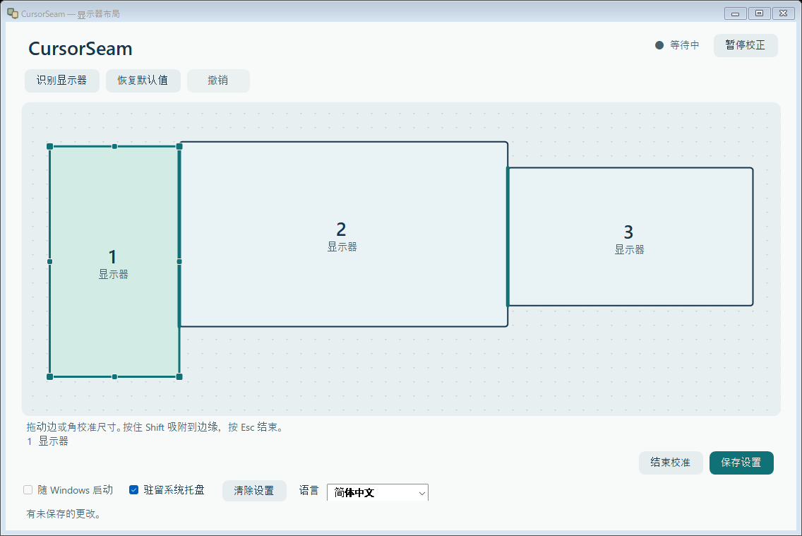

# CursorSeam

[日本語](../../README.md) · [English](../en/README.md) · [한국어](../ko/README.md) · **简体中文** · [繁體中文](../zh-Hant/README.md) · [Deutsch](../de/README.md) · [Français](../fr/README.md) · [Español](../es/README.md) · [Português (Brasil)](../pt-BR/README.md)

CursorSeam 是一款 Windows 应用，可校正鼠标指针跨越显示器边界时的位置偏移。适用于连接两台或更多显示器的电脑，包括显示器尺寸或分辨率不同的情况。

## 使用方法

1. 点击**识别显示器**查看编号，然后拖动屏幕边框，使布局与桌上的实际摆放一致。
2. 点击**校准实际尺寸**，拖动边缘或角点，让大小与实际显示器一致。按住 Shift 拖动即可吸附到相邻显示器的边缘。
3. 点击**保存设置**，将鼠标指针移过屏幕边界检查效果。

## 如何运行

在 Windows PowerShell 中运行 `.\build.ps1`，然后打开生成的 `CursorSeam.exe`。

## 许可证

[MIT 许可证](../../LICENSE)
