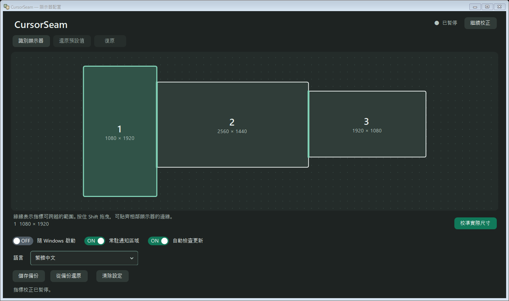
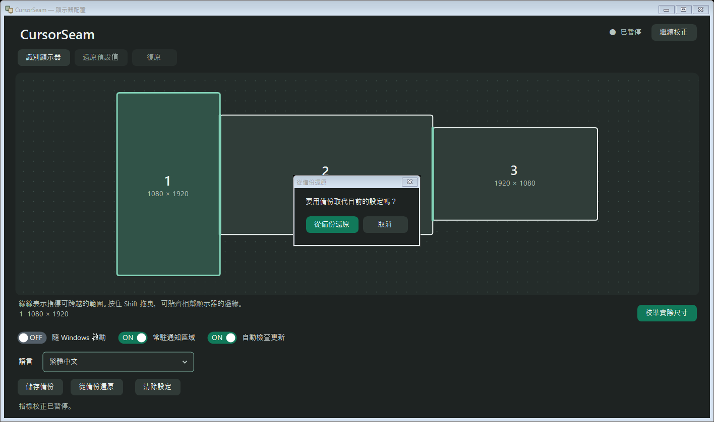

# CursorSeam

[日本語](../../README.md) · [English](../en/README.md) · [한국어](../ko/README.md) · [简体中文](../zh-Hans/README.md) · **繁體中文** · [Deutsch](../de/README.md) · [Français](../fr/README.md) · [Español](../es/README.md) · [Português (Brasil)](../pt-BR/README.md)

CursorSeam 是一款 Windows 應用程式，可校正滑鼠指標跨越螢幕邊界時的位置偏移。適用於連接兩台以上螢幕的電腦，包括螢幕尺寸或解析度不同的情況。

## 安裝

從[最新版本](https://github.com/nekomimiyks/CursorSeam/releases/latest)下載並執行 `CursorSeam-…-Setup.exe`。安裝完成後，選擇**是**立即啟動，或選擇**否**直接結束安裝程式。更新會保留現有設定。

## 使用方式

1. 點選**識別顯示器**查看編號，再拖曳螢幕邊框，使配置與桌面上的實際擺放一致。
2. 點選**校準實際尺寸**，拖曳邊緣或角落，讓大小與實際螢幕一致。按住 Shift 拖曳即可貼齊相鄰螢幕的邊緣。
3. 點選**儲存設定**，將滑鼠指標移過螢幕邊界確認效果。

## 1.1.2 更新內容

修正開關文字重疊，調整語言選項與設定按鈕的間距，並將實際尺寸校準按鈕移到配置面板右下方。GitHub 版可自動檢查更新並在應用程式中開始安裝，安裝時也可建立桌面捷徑。

## 備份與還原設定

選擇**儲存備份**，儲存 `.cursorseam` 檔案。還原時選擇**從備份還原**，選取檔案並確認。還原內容包括配置、實際尺寸、通知區域設定和語言。Windows 自動啟動請另外設定。

## 自動檢查更新

在 GitHub 版開啟**自動檢查更新**後，應用程式會在啟動後及執行期間每天檢查新版本。有更新時可選擇**更新**，下載並驗證安裝程式後開始安裝。安裝時可選擇是否建立桌面捷徑。

## 授權

[MIT 授權條款](../../LICENSE)
