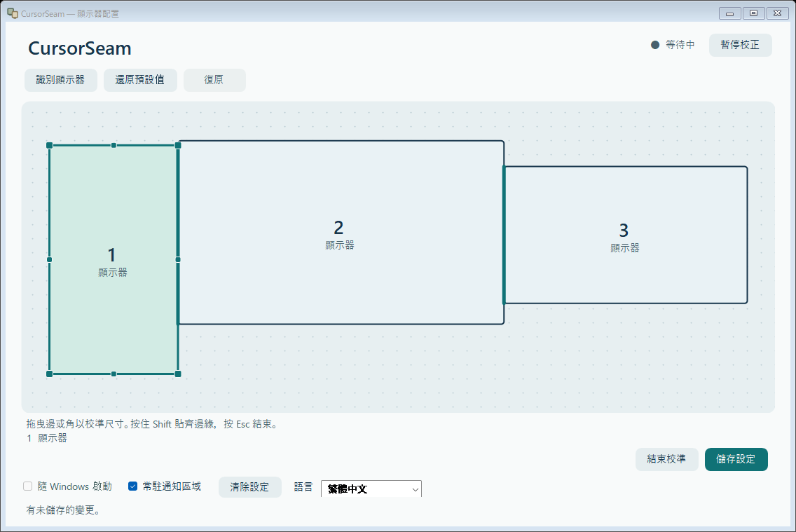

# CursorSeam

[日本語](../../README.md) · [English](../en/README.md) · [한국어](../ko/README.md) · [简体中文](../zh-Hans/README.md) · **繁體中文** · [Deutsch](../de/README.md) · [Français](../fr/README.md) · [Español](../es/README.md) · [Português (Brasil)](../pt-BR/README.md)

CursorSeam 是一款 Windows 應用程式，可校正滑鼠指標跨越螢幕邊界時的位置偏移。適用於連接兩台以上螢幕的電腦，包括螢幕尺寸或解析度不同的情況。

## 使用方式

1. 點選**識別顯示器**查看編號，再拖曳螢幕邊框，使配置與桌面上的實際擺放一致。
2. 點選**校準實際尺寸**，拖曳邊緣或角落，讓大小與實際螢幕一致。按住 Shift 拖曳即可貼齊相鄰螢幕的邊緣。
3. 點選**儲存設定**，將滑鼠指標移過螢幕邊界確認效果。

## 執行方式

在 Windows PowerShell 執行 `.\build.ps1`，再開啟產生的 `CursorSeam.exe`。

## 授權

[MIT 授權條款](../../LICENSE)
